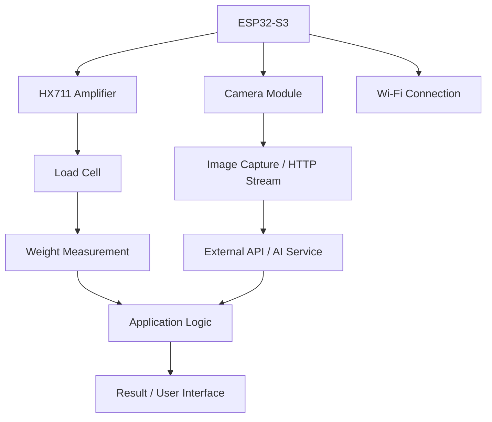

# NutriX_HardwareCodes
# 📷 Smart Vision & Weighing System — ESP32-S3

<p align="center">
  <strong>An embedded vision and weighing system integrating camera streaming, load-cell measurements, Wi-Fi connectivity, and AI-powered processing.</strong>
</p>

<p align="center">
  
  
  
  
</p>

---

## 📌 Overview

This project brings together **embedded computer vision, weight measurement, wireless communication, and AI-assisted processing** using an ESP32-S3-based camera system.

The firmware integrates a camera server with an HX711 load-cell interface, allowing the system to capture images, obtain weight readings, and communicate with external services over Wi-Fi. An external language-model API can be used to process requests and generate responses, enabling more intelligent interactions with the captured information.

The repository contains the main Arduino firmware, camera HTTP server implementation, camera pin definitions, board configuration, and supporting build configuration.

### ✨ Key Features

- 📸 **Camera Capture:** Capture still images through the ESP32 camera interface.
- 🎥 **Live Streaming:** Stream camera frames over HTTP using an MJPEG-style stream.
- ⚖️ **Weight Measurement:** Interface an HX711 load-cell amplifier for digital weight readings.
- 🔄 **Tare Support:** Support zeroing the scale through the configured tare mechanism, where enabled in the firmware.
- 📡 **Wi-Fi Connectivity:** Connect the embedded device to a wireless network.
- 🧠 **AI/API Integration:** Communicate with an external language-model service for AI-assisted processing.
- ⏱️ **Response Timeout Handling:** Configure how long the device waits for a server response before treating the request as timed out.
- 🛠️ **Configurable Camera Hardware:** Select a supported camera board and its GPIO assignments through configuration headers.

---

## 🏗️ System Architecture



The ESP32-S3 acts as the main controller. Camera operations and load-cell measurements provide the device's primary inputs, while Wi-Fi enables communication with external services.

The exact processing flow and displayed outputs depend on the implementation in the main Arduino sketch.

---

## 📂 Repository Structure

| File | Purpose |
|---|---|
| `MaruWebServer_test1(3).ino` | Main Arduino sketch. Contains the primary firmware logic, peripheral initialization, connectivity, and application workflow. |
| `app_httpd(2).cpp` | Implements the camera's HTTP server, including image capture, live streaming, camera status, and camera-control endpoints. |
| `board_config(3).h` | Selects the camera board configuration. The supplied configuration selects the ESP32-S3-EYE camera model and includes the camera pin definitions. |
| `camera_pins(3).h` | Defines GPIO assignments for supported camera boards, including camera data, clock, synchronization, and control signals. |
| `ci(1).yml` | Continuous-integration configuration for checking supported ESP32 camera build configurations. |

**Important:** Keep the main sketch and its supporting configuration/source files together. The camera server and configuration headers are dependencies of the firmware, not standalone applications.

---

## 🔍 File-by-File Explanation

### 1. `MaruWebServer_test1(3).ino` — Main Firmware

This is the primary entry point of the project and contains the application-specific logic.

Its responsibilities include:

- Initializing the ESP32 peripherals and application components.
- Managing Wi-Fi connectivity.
- Coordinating camera and load-cell functionality.
- Reading weight measurements from the HX711.
- Handling requests to external services, where configured.
- Processing server responses and handling communication errors.
- Managing the main program execution flow.

This file is the main place to look when modifying the overall behavior of the device, changing application logic, or troubleshooting initialization and API communication.

### 2. `app_httpd(2).cpp` — Camera HTTP Server

This file contains the HTTP server implementation used by the ESP32 camera application.

It provides handlers for common camera operations, including:

| Endpoint | Function |
|---|---|
| `/` | Serves the camera web interface. |
| `/capture` | Captures and returns a JPEG image. |
| `/stream` | Streams camera frames to a client. |
| `/status` | Returns camera and sensor configuration information. |
| `/control` | Handles supported camera-control commands. |
| `/bmp` | Returns a captured image in BMP format. |

The implementation uses the ESP32 camera and HTTP server APIs. It also handles image frame buffers, JPEG conversion where necessary, and camera parameters such as resolution and image quality.

**When to edit this file:** When changing camera endpoints, streaming behavior, capture handling, or the camera's HTTP interface.

### 3. `board_config(3).h` — Board Selection

This header determines which camera board configuration is active.

The supplied file selects:

```cpp
#define CAMERA_MODEL_ESP32S3_EYE
```

It then includes the camera pin definitions from `camera_pins.h`.

The selected board must match the actual hardware. An incorrect camera model can result in failed camera initialization or incorrect GPIO assignments.

### 4. `camera_pins(3).h` — Camera GPIO Mapping

This header defines the GPIO connections used by different supported camera boards.

Depending on the selected model, it specifies:

- Camera data pins (`Y2` through `Y9`)
- External clock (`XCLK`)
- SCCB/I²C-style camera control pins (`SIOD` and `SIOC`)
- Pixel clock (`PCLK`)
- Horizontal and vertical synchronization (`HREF` and `VSYNC`)
- Power-down and reset signals, when applicable

It also contains configurations for other compatible boards, allowing the camera setup to be adapted without rewriting the HTTP server.

**Hardware note:** GPIOs used by the camera should not be reassigned to other peripherals unless the selected board's pin mapping confirms that they are available.

### 5. `ci(1).yml` — Build Checks

The CI configuration defines ESP32 camera build configurations for automated checks.

It includes ESP32, ESP32-S2, and ESP32-S3 targets with different PSRAM and flash-related settings. This can help identify compilation or configuration issues across supported build environments.

Automated build checks do not, by themselves, verify physical hardware operation, camera image quality, load-cell accuracy, or external API availability.

---

## 🔌 Hardware Components

The project is designed around the following components, subject to the actual wiring and configuration used by the build:

| Component | Role |
|---|---|
| ESP32-S3 camera board | Main embedded controller and wireless communication |
| Camera module | Image capture and live video streaming |
| HX711 module | Amplifies and digitizes the load cell's signal |
| Load cell | Measures applied force/weight |
| Wi-Fi network | Enables access to remote services |
| External AI/API service | Performs language-model processing when enabled |
| Optional tare switch | Allows the scale to be zeroed when supported by the firmware |

### HX711 Pin Configuration

The load-cell wiring used during development is:

| HX711 signal | ESP32 GPIO |
|---|---:|
| DOUT / DT | GPIO 16 |
| SCK / CLK | GPIO 15 |

Verify these assignments against the current sketch before wiring the hardware.

If the tare switch is enabled in your current firmware, verify its configured GPIO and button wiring as well.

---

## ⚙️ Software Requirements

- Arduino IDE or a compatible Arduino build environment
- ESP32 board support package by Espressif Systems
- A compatible ESP32-S3 camera board configuration
- ESP32 camera libraries provided by the selected board package
- HX711 library matching the one included in the main sketch
- Any additional display, networking, or JSON libraries imported by the sketch
- Wi-Fi access
- Valid external API configuration, if AI processing is enabled

### Recommended Board Configuration

Select the exact ESP32-S3 camera board used by your hardware. The supplied configuration selects the ESP32-S3-EYE model.

The camera configuration also notes that PSRAM is required for higher-resolution image capture and that the partition scheme must provide sufficient application space for the firmware.

Use board and partition settings compatible with the selected hardware and the actual program size.

---

## 🚀 Getting Started

### 1. Clone the Repository

```bash
git clone <YOUR_GITHUB_REPOSITORY_URL>
cd <YOUR_REPOSITORY_NAME>
```

Replace the placeholders with your repository URL and folder name.

### 2. Open the Main Sketch

Open `MaruWebServer_test1(3).ino` in the Arduino IDE.

Keep the related `.cpp` and `.h` files available to the build system. If necessary, rename the files to conventional Arduino project names and update the corresponding include statements.

For example, the configuration files may be named `board_config.h` and `camera_pins.h` if the source includes those exact filenames.

### 3. Configure the ESP32 Board

1. Install the Espressif ESP32 board package.
2. Select the correct ESP32-S3 board.
3. Configure PSRAM and the partition scheme as required by the hardware and firmware.
4. Select the appropriate USB and flash settings for your development board.

### 4. Configure Credentials and API Settings

Enter the required Wi-Fi credentials and configure the external API endpoint and authentication details used by the sketch.

**Security:** Never commit Wi-Fi passwords, API keys, access tokens, or other secrets to a public repository. Use a separate secrets/configuration file excluded through `.gitignore`, or provide credentials through a secure configuration mechanism.

### 5. Connect the Hardware

Connect the camera according to the selected board's pin mapping. Wire the HX711 to the load cell and connect its data and clock signals to the configured GPIOs.

Check the supply voltage, common ground, pin assignments, and load-cell wiring before powering on the system.

### 6. Compile and Upload

Compile the sketch, resolve any missing library or configuration errors, and upload it to the ESP32-S3.

Open the Serial Monitor at the baud rate configured by the sketch to inspect startup messages, connectivity status, peripheral initialization, and errors.

### 7. Test the Components

Test the system in stages:

1. Confirm that the ESP32 starts successfully.
2. Verify Wi-Fi connectivity.
3. Test camera capture and the live stream.
4. Check that the HX711 produces stable weight readings.
5. Verify tare behavior if configured.
6. Test the external API request and response handling.

---

## ⏱️ API Response Timeouts

The AI/API workflow may take longer than ordinary local sensor operations because the request can involve network communication and remote model inference.

If the firmware uses a loop similar to:

```cpp
unsigned long responseStart = millis();

while (!client.available() &&
       client.connected() &&
       millis() - responseStart < 20000) {
  delay(10);
}
```

the `20000` value represents a maximum wait of approximately **20 seconds for the first response data** in that loop. `responseStart` stores the time at which the wait begins.

Increasing this value does not automatically increase timeouts imposed by the remote server, API gateway, or backend. It also does not guarantee that the complete response will arrive within that duration; the subsequent response-reading logic must be handled separately.

Choose a timeout that fits the expected API latency and ensure that the server-side limits are compatible.

---

## 🧰 Troubleshooting

| Problem | What to check |
|---|---|
| Camera initialization fails | Confirm the selected camera model, GPIO mapping, board selection, and PSRAM settings. |
| Camera stream does not load | Verify Wi-Fi connectivity, the device IP address, and the camera HTTP server startup logs. |
| HX711 readings are missing | Check DOUT/SCK wiring, power, common ground, initialization, and library compatibility. |
| Weight values fluctuate | Check mechanical stability, load-cell wiring, calibration, power supply, and filtering. |
| Tare does not work | Verify that the tare feature is enabled, the switch pin is correct, and the button logic is being executed. |
| API requests time out | Check Wi-Fi signal, DNS/connectivity, API credentials, server logs, response parsing, and all relevant timeout settings. |
| Compilation fails | Check file names, include statements, installed libraries, selected board, and partition configuration. |

---

## 🔐 Security and Reliability

- Keep API credentials out of source control.
- Use HTTPS and validate server responses when supported by the networking implementation.
- Handle connection failures, malformed responses, and unexpected HTTP status codes.
- Avoid assuming that an HTTP connection means the complete AI response has been received.
- Calibrate the load cell and verify readings with known weights.
- Check GPIO conflicts before adding buttons or other peripherals.
- Test camera, scale, Wi-Fi, and API functionality independently before testing the complete workflow.

---

## 🛣️ Potential Future Improvements

- Add structured logging for camera, scale, and API events.
- Improve weight filtering and calibration workflows.
- Add a clearer user interface for weight readings and AI responses.
- Improve recovery behavior after Wi-Fi disconnections or failed API calls.
- Separate credentials and configuration from the main firmware.
- Add automated tests for response parsing and application logic.
- Document the complete wiring diagram and validated hardware configuration.

---

## 📄 License

The camera HTTP server source includes Espressif copyright and Apache License 2.0 notices. Preserve the original notices when redistributing that source.

Choose and document an appropriate license for your own project-specific code before publishing the repository for reuse.

---

## 👨‍💻 Project Summary

This repository provides the firmware and supporting configuration for an ESP32-S3-based embedded system combining camera functionality, load-cell measurement, Wi-Fi connectivity, and external AI/API communication.

The code is organized into a main application sketch, camera HTTP server implementation, board and pin configuration headers, and a CI build configuration. Together, these files provide the foundation for developing and extending the device's embedded vision and weighing capabilities.
